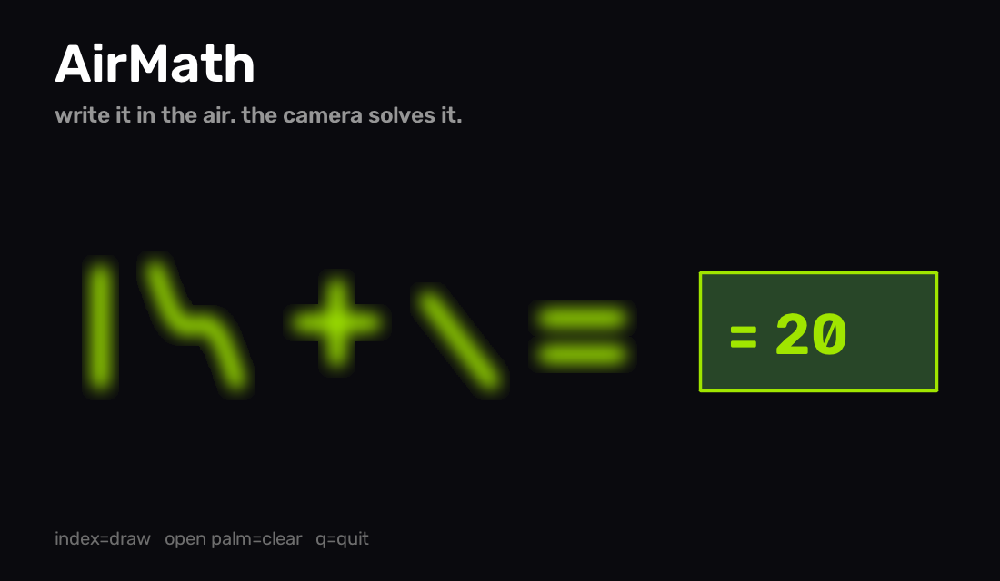

# AirMath

Write math in the air with your finger — the webcam tracks your hand, recognizes each character you "write", and solves the equation live on screen.

`12 + 8` written in the air prints **12 + 8 = 20** on the frame. No paper, no mouse, no typing.



## How it works

```
webcam frame
   └─ MediaPipe Hands            → index fingertip + pen up/down
        └─ AirCanvas             → ink points, one glyph per pen-up
             └─ segment.py       → smeared blobs split on x-gaps
                  └─ recognizer  → operators by shape rules + digits by MNIST 1-NN
                       └─ solver → tokens in x-order, "= " ends the expression
                            └─ result drawn back on the frame
```

- **Digits 0–9**: 1-nearest-neighbour over a 12,000-image MNIST subset shipped in the repo (`src/airmath/models/digits.npz`), validated at ~97% on a held-out sample.
- **Operators** (`+ - * / =`): geometric rules on the ink mask — spines, bands, diagonals. They are too distinctive to need a model.
- **Pen gestures**: index finger extended = draw, index folded = pen up, open palm = wipe everything.

## Install

```bash
pip install git+https://github.com/Ankitavasudev/airmath@main
```

Python 3.9+, plus `opencv-python`, `mediapipe`, `numpy`. The model file is committed, so there is nothing to train.

## Run

```bash
airmath                 # camera 0
airmath --camera 1      # second webcam
```

| gesture | action |
|---|---|
| index finger extended, moving | draw |
| fold the index finger | pen up (ends one glyph) |
| open palm | clear canvas |
| `q` | quit |

Write one number, the operator, another number, then `=`. Answer appears bottom-left; keep writing to chain more.

## Test

```bash
pip install pytest
pytest
```

The test suite is fully headless — no camera needed. Recognizer/solver/canvas are decoupled from MediaPipe, and `run_over_frame` takes a fake `HandState`, so the whole drawing→recognition→solve pipeline is covered by straight-line tests.

## Retrain the recognizer (optional)

```bash
py scripts/train_recognizer.py --samples 12000
```

Downloads MNIST once (~15 MB), sanity-checks 1-NN accuracy, and refreshes `models/digits.npz`.

## Project layout

```
src/airmath/
  app.py           frame loop + HUD + session state
  hand_tracker.py  MediaPipe hand landmarks → HandState
  canvas.py        strokes → glyphs (pen-up segmentation)
  segment.py       blob splitting on x-axis ink gaps
  recognizer.py    glyph → token (operator rules + MNIST 1-NN)
  solver.py        token stream → answer
  models/digits.npz  shipped MNIST subset
scripts/train_recognizer.py
tests/             headless pytest suite
```

## License

MIT — see [LICENSE](LICENSE).
